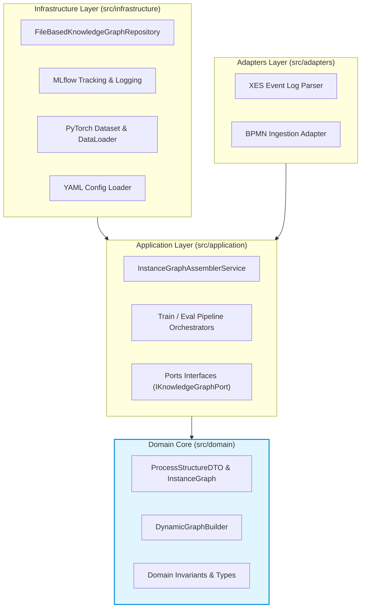
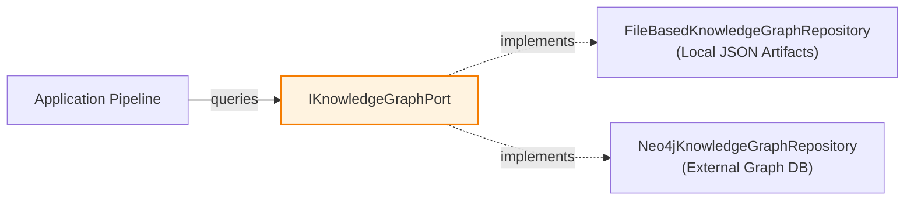
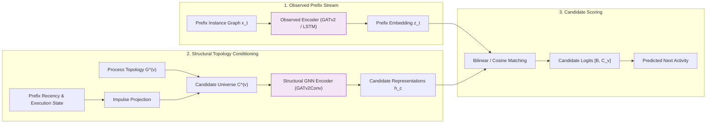

# System Architecture & Technical Design

This document details the architectural principles, component decoupling, and neural network mechanisms implemented in `bpm_prediction`.

---

## 1. Clean Hexagonal Architecture

The repository adheres strictly to **Clean Architecture** (Ports and Adapters) principles to guarantee domain independence, testability, and separation of research concerns:



### Layer Dependency Invariants:
1. **`src/domain/`**: Contains pure domain logic, entities, and data contracts (`ProcessStructureDTO`, `InstanceGraph`). It has **zero dependencies** on external frameworks (PyTorch, databases, or application use cases).
2. **`src/application/`**: Houses pipeline orchestrators, graph assembly services, and port definitions (`IKnowledgeGraphPort`). It depends strictly on the Domain layer.
3. **`src/adapters/`**: Implements raw format ingestion (XES log parsing, BPMN XML processing).
4. **`src/infrastructure/`**: Contains concrete repository implementations, neural network training loops, and MLflow logging.

> **Automated Boundary Enforcement:** Layer dependencies are validated via an automated AST analyzer:
> ```bash
> python tools/architecture_guard.py
> ```
> Any import violating the clean architecture rules causes immediate CI failure.

---

## 2. Decoupled Knowledge Graph Port (`IKnowledgeGraphPort`)

To make the experimental package completely self-contained and reproducible without complex external infrastructure (e.g., live Neo4j database containers), the architecture encapsulates process topology storage behind the `IKnowledgeGraphPort` interface:



### File-Based Local Repository (`backend: file`):
- Process structures are persisted as atomic JSON artifacts under:
  ```text
  data/knowledge_graph/<process_name>/<version>/process_structure.json
  ```
- Each artifact encapsulates vertices (tasks, gateways), directed sequence flows, and transition statistics.
- **Benefits for Peer Review:** Zero setup requirements; evaluations run 100% locally from the filesystem with millisecond retrieval times and absolute reproducibility.

---

## 3. Topology-Conditioned Model Architecture (`EOPKGTopologyConditioned`)

Unlike standard recurrent networks or vanilla GNNs that classify prefixes over a static set of output classes, the core predictive model employs **topology-conditioned candidate scoring**:



### Forward Execution Flow:
1. **Observed Trace Encoding:** The execution prefix graph $x_t$ (events, resource allocations, duration vectors) is mapped to a latent trace representation $z_t \in \mathbb{R}^d$.
2. **Dynamic Candidate Universe $C^{(v)}$:** Extracted dynamically from the specific process version $v$ governing the current trace.
3. **Impulse State Injection:** Recency, visit count, and active boundary states from the prefix are projected into candidate nodes of $G^{(v)}$.
4. **Structural Propagation:** A multi-layer Graph Attention Network (`GATv2Conv`) propagates impulse activation along process sequence flows, capturing which downstream tasks are reachable.
5. **Candidate Scoring:** A bilinear scoring head computes compatibility logits between the prefix embedding $z_t$ and reachable candidate representations $h_c$:
   $$s(z_t, c) = z_t^\top W h_c$$
   This enables the model to score newly introduced activities that were never present in historical training vocabularies.
