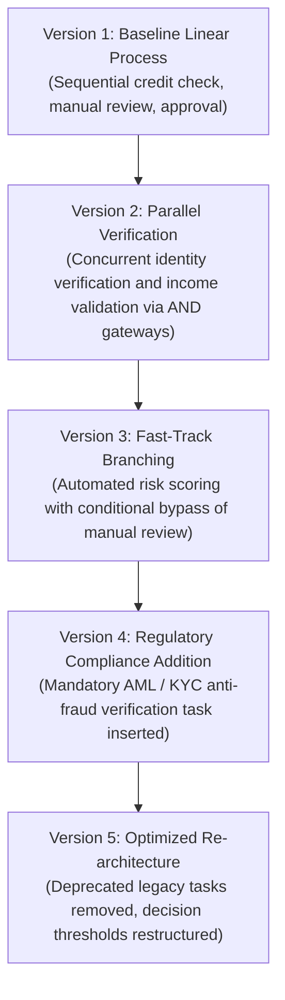
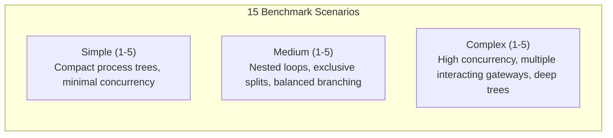

# Experimental Benchmarks & Dataset Provenance

This document describes the experimental benchmarks, simulated process evolutions, and dataset artifacts provided with this replication package.

---

## 1. Overview of Evaluated Benchmarks

The toolkit provides two benchmark suites designed to evaluate predictive monitoring models under controlled structural concept drift:

| Benchmark Suite | Process Type | Number of Datasets | Versions per Dataset | Key Evaluation Focus |
| :--- | :--- | :--- | :--- | :--- |
| **Loan Process Evolution** | Semi-synthetic banking simulation | 1 primary complex log | 5 versions ($v_1 \to v_5$) | Realistic business workflow, multi-resource pools, temporal drift windows. |
| **CDLG Benchmark Suite** | Synthetic process-tree mutations | 15 distinct datasets | 5 versions each | Systematic structural drift across Simple, Medium, and Complex topologies. |

---

## 2. Loan Process Evolution Benchmark (`loan_v1_v5_complex_simulated`)

The primary evaluation dataset models an evolving loan application process in a commercial financial institution across 5 sequential business versions:



### Dataset Characteristics:
- **Event Log:** `data/loan/loan_v1_v5_complex_simulated.zip` ($\to$ `.xes`).
- **Trace Volume:** Over 24,000 completed cases spanning multiple months of simulated activity.
- **Realistic Dynamics:**
  - Case arrivals governed by a non-homogeneous Poisson process.
  - Activity durations sampled from empirical lognormal distributions.
  - Activity-specific resource pools preventing unrealistic concurrent multitasking.
- **Pre-built Topologies:** Complete process structure models for all 5 versions are available in:
  ```text
  data/knowledge_graph/loan_v1_v5_complex_simulated/v1/ ... /v5/process_structure.json
  ```

---

## 3. CDLG Synthetic Benchmark Suite

The CDLG (*Concept Drift Log Generator*) suite evaluates model generalizability across 15 distinct topological settings generated via controlled evolutionary process-tree mutations:



### Complexity Categories:
1. **Simple (`cdlg-simple1` to `cdlg-simple5`):** Small process models (6–12 activities) with single-point evolutionary edits (task insertion/deletion).
2. **Medium (`cdlg-medium1` to `cdlg-medium5`):** Intermediate process models (12–25 activities) incorporating concurrent execution and loop constructs.
3. **Complex (`cdlg-complex1` to `cdlg-complex5`):** Enterprise-scale process models (>25 activities) with deeply nested parallel (`AND`) and exclusive (`XOR`) gateways.

Each CDLG dataset comprises:
- An aligned versioned XES log: `data/cdlg/run-*/dataset.xes`.
- Five corresponding offline process structures: `data/knowledge_graph/cdlg-<complexity><id>/v1/ ... /v5/process_structure.json`.

---

## 4. Pre-trained Checkpoints & Reproducibility Matrix

To facilitate immediate verification without requiring hours of GPU pre-training, pre-trained weights for all benchmark scenarios are bundled in `checkpoints/`:

- **Naming Schema:**
  - `_<Model>-<Seed>_<Dataset>_best.pth`: Best checkpoint on validation split during historical pre-training.
  - `_<Model>-<Seed>_<Dataset>_<hash>_finetune.pth`: Checkpoint captured during online sliding-window drift adaptation.
- **Model Classes Provided:**
  - `EOPKG` / `EOPKGTopologyConditioned` (Proposed topology-conditioned models).
  - `GATv2+Mask` (Mask-guided graph attention baselines).
  - `LSTM` / `Base` (Standard sequence models).
