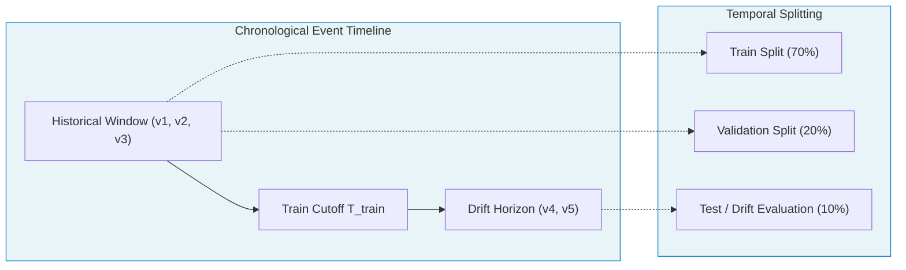
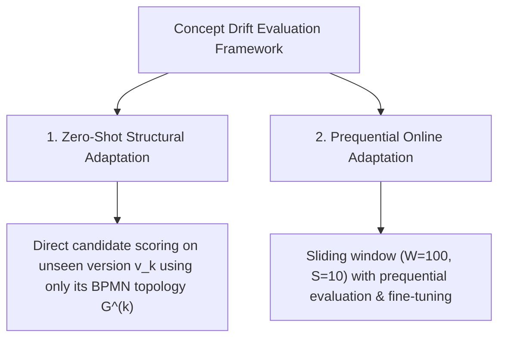

# Scientific Methodology & Experimental Guardrails

This document establishes the experimental methodology, anti-leakage verification protocols, and reproducibility standards implemented in this research package.

---

## 1. Research Objectives & Core Hypotheses

Standard Predictive Business Process Monitoring (PBPM) models (e.g., LSTMs, Transformers, and standard GNNs) assume a closed-world setting with a stationary process and a fixed activity vocabulary:
$$\mathcal{Y}_{train} = \mathcal{Y}_{test}$$

In real-world enterprise environments, business processes frequently undergo **concept drift** and **structural process evolution** (e.g., introduction of new regulatory verification tasks, removal of deprecated activities, changes in concurrency and decision gateways). Under such structural drift:
1. The activity vocabulary changes: $\mathcal{Y}^{(v_{new})} \neq \mathcal{Y}^{(v_{old})}$.
2. Fixed-head classification layers fail catastrophically because they cannot emit probabilities for newly introduced activities without extensive historical retraining data.

### Core Hypothesis
By explicitly conditioning the model on the formal **process topology** $G^{(v)} = (V^{(v)}, E^{(v)})$ and routing execution state through graph neural representations, the system can perform **zero-shot and few-shot adaptation** to unseen process versions without requiring immediate large-scale trace histories for newly released process variants.

---

## 2. Prevention of Data Leakage (Temporal Rigor)

In process mining and event log analysis, traditional $k$-fold cross-validation or uniform trace-level random splitting causes severe **future lookahead bias** (temporal leakage), as models inadvertently learn from future process instances to predict past instances. 

To ensure peer-review rigor, this toolkit enforces strict chronological guardrails:

### 2.1 Version Scoping Policy (`version_scope_policy: train_cut`)
- **Training Horizon:** When `version_scope_policy = train_cut`, training datasets strictly ingest event traces belonging only to process versions that appeared prior to the chronological split cutoff $T_{train}$.
- **Unseen Versions:** Future process versions ($v_{new}$) are strictly quarantined to the test/evaluation partition, guaranteeing that the model evaluates true generalization and structural adaptation rather than memorization.

### 2.2 Strict Statistical Snapshot Lookups (`stats_time_policy: strict_asof`)
When incorporating statistical features (e.g., node execution frequency, duration percentiles, transition probabilities):
- Statistical snapshots are timestamped offline.
- During instance graph assembly, runtime queries enforce:
  $$t_{snapshot} \le t_{event}$$
- Future event data cannot leak into prefix node features.
- If a required temporal snapshot is missing, the quality gate raises an error (`on_missing_asof_snapshot: raise`), preventing silent fallback to unconstrained statistics.

---

## 3. Determinism & Reproducibility Protocol

To ensure exact reproducibility across independent evaluators, all experiments are governed by a deterministic configuration matrix:

1. **Explicit Seed Management:**
   Multi-seed benchmarking is conducted across fixed seeds:
   $$\text{Seeds} \in \{13, 32, 42, 55, 67, 78, 99\}$$
   Each seed simultaneously pins:
   - Python standard library `random` seed
   - NumPy pseudorandom generator (`np.random.seed`)
   - PyTorch CPU RNG (`torch.manual_seed`)
   - PyTorch CUDA RNG (`torch.cuda.manual_seed_all`)
   - Deterministic cuDNN backends (`torch.backends.cudnn.deterministic = True`)

2. **Immutable Pre-built Graph Artifacts:**
   Training and evaluation pipelines never parse raw BPMN models or extract graph metrics synchronously in the training loop. All structural artifacts are pre-built offline and stored immutably in `data/knowledge_graph/`, eliminating runtime non-determinism and network latency.

3. **Checkpoint Verification:**
   All evaluated models have corresponding pinned checkpoint weights (`.pth`) tracked with SHA-256 hashes.

---

## 4. Concept Drift Evaluation Protocols

Experiments evaluate model robustness under process change using two complementary evaluation protocols:

### 4.1 Zero-Shot Structural Adaptation
Evaluates model accuracy on the very first traces of a newly deployed process version $v_{next}$ before any training traces of that version are seen by the model. Predictions are guided solely by the structural priors of the new process schema.

### 4.2 Prequential Online Adaptation (`eval_drift_finetune`)
Models real-world deployment where traces of an evolving process arrive in a streaming fashion:
- **Sliding Evaluation Window:** Default window size $W = 100$ cases, stride $S = 10$ cases.
- **Prequential Protocol:** Each incoming window of traces is first used to test the model (recording prequential accuracy/F1), followed by selective gradient updates (fine-tuning) on observed cases.
- **Metrics Tracked:**
  - Micro / Macro / Weighted F1 Score
  - Target-in-Mask Ratio (frequency with which the true activity is structurally valid in the current topology)
  - Out-of-Scope (OOS) Rate
